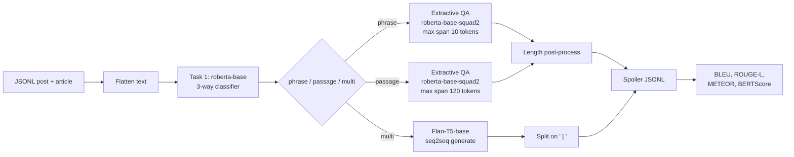

# Clickbait Spoiling

[](https://www.python.org/)
[](https://pytorch.org/)
[](https://github.com/huggingface/transformers)
[](LICENSE)
[](https://pan.webis.de/semeval23/pan23-web/clickbait-challenge.html)

Two-stage system for [SemEval-2023 Task 5](https://aclanthology.org/2023.semeval-1.312/) (PAN Clickbait Challenge): classify the spoiler a headline needs, then extract or generate that spoiler from the linked article.

Repository: [aryonmt/clickbait-spoiling-IR-final-project](https://github.com/aryonmt/clickbait-spoiling-IR-final-project)

## Overview

Clickbait posts advertise a linked page by opening a curiosity gap instead of stating the fact. **Clickbait spoiling** closes that gap. Given the post and the article, the system does three things:

1. Read the headline (`postText`) and the linked article (`targetParagraphs`).
2. Classify the spoiler type: **phrase** (a short span), **passage** (a sentence or paragraph), or **multi** (several parts).
3. Return the spoiler itself, so a reader can skip the article.

This repository trains a type classifier and type-specific spoilers, then runs them as one inference pipeline. It follows the JSONL schema of the [Webis Clickbait Spoiling Corpus 2022](https://webis.de/data.html#clickbait-spoiling-corpus-2022), the dataset behind the SemEval task. Dataset files are not committed.

## Architecture



| Stage | What it does | Where |
| --- | --- | --- |
| Load | Read JSONL into a dataframe and check `uuid`, `postText`, `targetParagraphs`, `tags` | `src/data_loader.py` |
| Classify | Pair the post with the first 8 paragraphs and predict `phrase`, `passage`, or `multi` | `src/transformer_classifier.py` |
| Phrase / passage | Fine-tune extractive QA; decode the best span from start and end logits | `src/qa_preprocessor.py`, `src/qa_inference.py` |
| Multi | Generate a `" \| "`-joined answer with Flan-T5, then split it | `src/seq2seq_qa_preprocessor.py` |
| Cleanup | Cap phrase spoilers at 6 words; expand a very short passage span to its sentence | `src/postprocessor.py` |
| Score | Classification report plus sentence BLEU, ROUGE-L, METEOR, and BERTScore | `src/evaluation.py` |

Alternate multi paths, selected with `--multi_strategy`, are iterative extractive QA (`extractive_iterative`) and lexical sentence retrieval (`jaccard`). Retrieval ranks article sentences by token Jaccard overlap. The checked-in validation report uses the seq2seq path.

## Method

| Component | Checkpoint | Objective | Settings |
| --- | --- | --- | --- |
| Task 1 classifier | [`roberta-base`](https://huggingface.co/roberta-base) | Weighted cross-entropy, inverse-frequency class weights | 512 tokens, batch 8, gradient accumulation 2, lr `2e-5`, 5 epochs, warmup 50, weight decay `0.01`, fp32. Best checkpoint by macro F1. |
| Phrase and passage QA | [`deepset/roberta-base-squad2`](https://huggingface.co/deepset/roberta-base-squad2) | Model QA loss inside Hugging Face `Trainer` | 512 tokens, stride 128, batch 8, lr `3e-5`, 3 epochs, fp16. Separate fine-tunes on phrase-only and passage-only rows. Best checkpoint by answerable token F1. |
| Multi generator | [`google/flan-t5-base`](https://huggingface.co/google/flan-t5-base) | Seq2seq loss; pad label ids set to `-100` | Source 512, target 128, batch 4, lr `5e-5`, 3 epochs, fp16, `predict_with_generate`. |
| Span decode | — | Argmax of `start_logits[s] + end_logits[e]` inside the article window | Phrase cap 10 tokens, passage cap 120 tokens. The returned string is a character slice of the article, not a `decode()` of the span. |
| Multi decode | — | `generate(max_length=128)`, then `decode(skip_special_tokens=True)` | Split on `\|`. An empty generation falls back to the first paragraph. |

Task 1 truncates the article to eight paragraphs so the pair fits in 512 tokens. Task 2 keeps the full article and slides a 512-token window with stride 128. If a gold spoiler cannot be aligned to the current window, training labels that window with the CLS index.

Prompt used for Flan-T5:

```text
question: {post} context: {article}
```

Gold multi spoilers are joined as `part one | part two`.

## Evaluation

Scores below are the checked-in validation report in [`reports/metrics_summary.json`](reports/metrics_summary.json). The comparison column is this project's **Phase 0** run, hardcoded in `src/visualization_suite.py`. It is not an official SemEval leaderboard entry. BLEU is corpus-mean `sentence_bleu` with smoothing method 1 (4-gram). ROUGE-L is the stemmed F-measure. BERTScore uses `bert_score` with `lang="en"` and no custom `model_type` (library default `roberta-large`).

| Metric | Phase 0 | This run | Delta |
| --- | ---: | ---: | ---: |
| Task 1 accuracy | 0.7363 | 0.7225 | −0.0138 |
| Task 1 macro F1 | 0.7308 | 0.7177 | −0.0131 |
| Task 2 mean BLEU | 0.1682 | 0.1934 | +0.0252 |
| Task 2 mean ROUGE-L | 0.4336 | 0.4493 | +0.0157 |
| Task 2 mean METEOR | — | 0.4109 | — |
| Task 2 mean BERTScore | — | 0.9045 | — |

Per predicted type on the same report:

| Type | Precision | Recall | F1 | BLEU | ROUGE-L | METEOR | BERTScore |
| --- | ---: | ---: | ---: | ---: | ---: | ---: | ---: |
| phrase | 0.7492 | 0.7403 | 0.7447 | 0.1875 | 0.6170 | 0.5055 | 0.9344 |
| passage | 0.7311 | 0.6925 | 0.7113 | 0.2389 | 0.3707 | 0.3685 | 0.8939 |
| multi | 0.6524 | 0.7483 | 0.6971 | 0.1046 | 0.2334 | 0.2849 | 0.8581 |

The notebook log for the run that produced these files used 3,200 training posts and 800 validation posts (phrase 1,367/335, passage 1,274/322, multi 559/143). The JSON report itself does not store the split size. A 0.50% CLS-fallback figure in that report is an estimate written when `label_quality_stats.json` is absent.

Hagen et al. (2022) report about 80% spoiler-type accuracy and strong extractive results with DeBERTa-large on Webis-Clickbait-22. Those figures describe their paper system, not this repository.

## Quickstart

Python 3.10 or newer. Training and fp16 evaluation expect a CUDA GPU. See [Hardware](#hardware) before launching a full train.

```bash
git clone https://github.com/aryonmt/clickbait-spoiling-IR-final-project.git
cd clickbait-spoiling-IR-final-project
python -m venv .venv
# Windows: .venv\Scripts\activate
# Unix:    source .venv/bin/activate
pip install -r requirements.txt
python -c "import nltk; nltk.download('punkt'); nltk.download('punkt_tab'); nltk.download('wordnet'); nltk.download('omw-1.4')"
```

Place the corpus at `data/train.jsonl` and `data/validation.jsonl`. Each line needs `uuid`, `postText`, `targetParagraphs`, and `tags`, plus `spoiler` for training and scoring. Download the corpus from [Webis](https://webis.de/data.html#clickbait-spoiling-corpus-2022). The first training run also downloads the Hugging Face checkpoints named above, and Task 1 downloads the `evaluate` F1 metric.

```bash
python main_transformer_task1.py --train_path data/train.jsonl --val_path data/validation.jsonl
python main_transformer_task2_train.py --spoiler_type phrase --train_path data/train.jsonl --val_path data/validation.jsonl
python main_transformer_task2_train.py --spoiler_type passage --train_path data/train.jsonl --val_path data/validation.jsonl
python main_transformer_task2_multi_seq2seq.py --train_path data/train.jsonl --val_path data/validation.jsonl
python main_integrated_pipeline.py --val_path data/validation.jsonl --t1_checkpoint outputs --phrase_checkpoint results_qa_phrase --passage_checkpoint results_qa_passage
python main_generate_report.py --predictions_path final_integrated_submission.jsonl --val_path data/validation.jsonl --output_dir reports
```

Seq2seq weights are read from `results_multi_seq2seq` (`PipelineConfig.task2_multi_seq2seq_dir`), not from a CLI flag. If that directory is missing, multi spoilers fall back to Jaccard retrieval.

One validation row, after the checkpoints exist:

```python
from src.config import PipelineConfig
from src.data_loader import JSONLLoader
from main_integrated_pipeline import ClickbaitIntegratedPipeline

pipeline = ClickbaitIntegratedPipeline(
    task1_dir="outputs",
    phrase_dir="results_qa_phrase",
    passage_dir="results_qa_passage",
    config=PipelineConfig(),
)
frame = JSONLLoader("data/validation.jsonl").load_data().head(1)
tags, spoilers, confidence = pipeline.run_inference(frame)
print(tags[0], spoilers[0], round(confidence[0], 4))
```

`run_inference` returns the predicted tag, a list of spoiler strings, and the softmax confidence of the predicted class. The submission file is JSONL with `uuid`, `spoilerType`, `spoiler`, and `confidence`.

## Hardware

Nothing in the training loop records peak VRAM. The ranges below are estimates for the default batch sizes and sequence lengths, not measurements.

| Run | Precision | Batch | Rough VRAM |
| --- | --- | --- | --- |
| Task 1, `roberta-base`, sequences up to 512 | fp32 | 8 (accumulation 2 does not shrink the microbatch) | about 16 GB |
| Phrase or passage QA, windows padded to 512 | fp16 | 8 | about 12–16 GB |
| Flan-T5-base, source 512, generation on eval | fp16 | 4 | about 16 GB |
| Integrated inference, classifier plus both QA models resident | fp32 load of the saved checkpoints | one example at a time for QA and generation | about 8 GB |

`fp16=True` on the QA and seq2seq trainers requires CUDA. There is no bf16 switch. BERTScore downloads `roberta-large` on first use and can add several gigabytes during report generation.

## Repository layout

```text
clickbait-spoiling/
├── main_eda.py                              # exploratory analysis on data/train.jsonl
├── main_transformer_task1.py                # train the type classifier
├── main_transformer_task2_train.py          # train phrase or passage QA
├── main_transformer_task2_multi_seq2seq.py  # train Flan-T5 for multi spoilers
├── main_integrated_pipeline.py              # classify, spoil, write JSONL
├── main_generate_report.py                  # metrics, plots, HTML report
├── notebook.ipynb                           # Kaggle runner for the same entry points
├── requirements.txt
├── CITATION.cff
├── reports/
│   ├── metrics_summary.json
│   └── comparison_to_baseline.json
└── src/
    ├── config.py                    # model ids, lengths, learning rates
    ├── data_loader.py               # JSONL load and tag filter
    ├── transformer_classifier.py    # Task 1
    ├── qa_preprocessor.py           # extractive span labels
    ├── qa_inference.py              # start/end logit decode
    ├── seq2seq_qa_preprocessor.py   # Flan-T5 features
    ├── multi_spoiler_extractor.py   # iterative QA multi path
    ├── retrieval_generator.py       # Jaccard multi path
    ├── postprocessor.py             # phrase and passage length rules
    ├── evaluation.py
    └── visualization_suite.py
```

`data/`, checkpoints (`outputs/`, `results_qa_phrase/`, `results_qa_passage/`, `results_multi_seq2seq/`), and Hugging Face caches are gitignored.

## References

```bibtex
@inproceedings{hagen-etal-2022-clickbait,
  title = "Clickbait Spoiling via Question Answering and Passage Retrieval",
  author = "Hagen, Matthias and Fr{\"o}be, Maik and Jurk, Artur and Potthast, Martin",
  booktitle = "Proceedings of the 60th Annual Meeting of the Association for Computational Linguistics (Volume 1: Long Papers)",
  month = may,
  year = "2022",
  address = "Dublin, Ireland",
  publisher = "Association for Computational Linguistics",
  url = "https://aclanthology.org/2022.acl-long.484/",
  doi = "10.18653/v1/2022.acl-long.484",
  pages = "7025--7036"
}

@inproceedings{frobe-etal-2023-semeval,
  title = "{S}em{E}val-2023 Task 5: Clickbait Spoiling",
  author = "Fr{\"o}be, Maik and Stein, Benno and Gollub, Tim and Hagen, Matthias and Potthast, Martin",
  booktitle = "Proceedings of the 17th International Workshop on Semantic Evaluation (SemEval-2023)",
  month = jul,
  year = "2023",
  address = "Toronto, Canada",
  publisher = "Association for Computational Linguistics",
  url = "https://aclanthology.org/2023.semeval-1.312/",
  doi = "10.18653/v1/2023.semeval-1.312",
  pages = "2275--2286"
}
```

Software citation: see [`CITATION.cff`](CITATION.cff). Pretrained weights remain under their original licenses (`roberta-base`, `deepset/roberta-base-squad2`, `google/flan-t5-base`). This MIT license covers the code in this repository.
